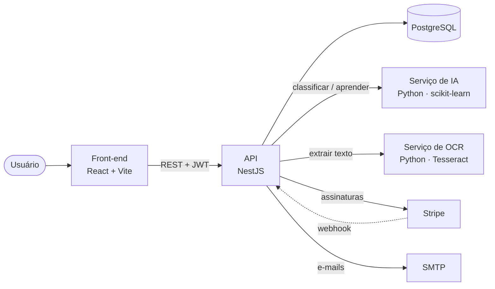
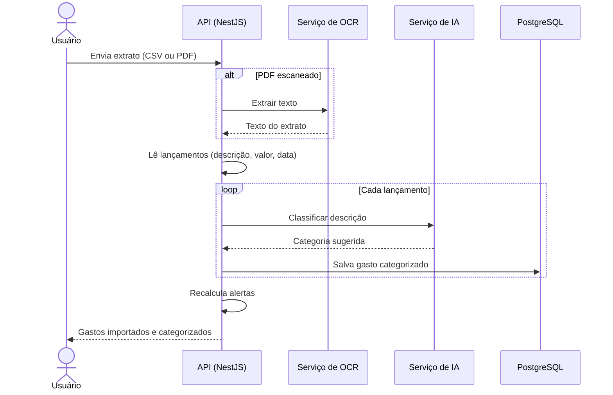
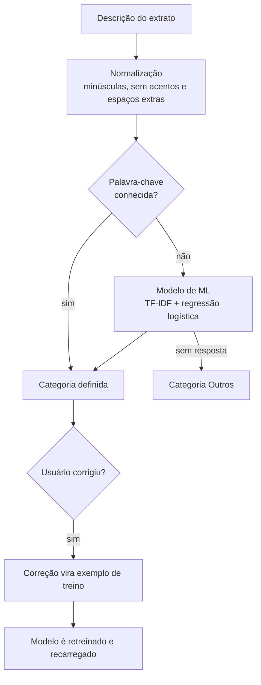
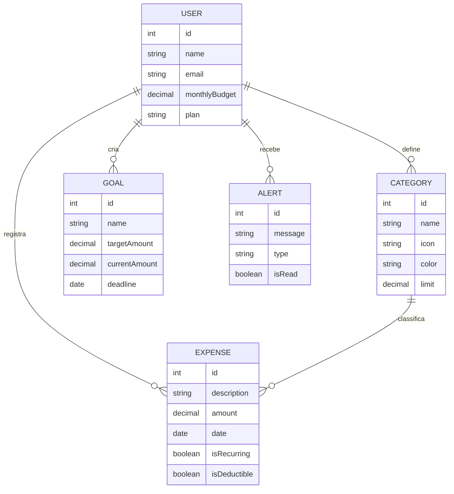

# SmartSaldo

**Controle financeiro pessoal com categorização automática de gastos por inteligência artificial.**

> Este repositório reúne o back-end e os serviços de IA. A interface web está em [SmartSaldoFront](https://github.com/Thomasramos02/SmartSaldoFront).

---

## Sumário

1. [Objetivo](#1-objetivo)
2. [Problema](#2-problema)
3. [Solução](#3-solução)
4. [Requisitos](#4-requisitos)
5. [Arquitetura](#5-arquitetura)
6. [Categorização inteligente](#6-categorização-inteligente)
7. [Modelo de dados](#7-modelo-de-dados)
8. [Tecnologias](#8-tecnologias)
9. [Decisões técnicas](#9-decisões-técnicas)
10. [Autor](#10-autor)

---

## 1. Objetivo

O SmartSaldo ajuda pessoas a entender para onde vai o próprio dinheiro com o mínimo de esforço manual. A meta do projeto é transformar o extrato bancário, que é uma lista confusa de lançamentos, em informação organizada: gastos por categoria, evolução mês a mês, metas de economia e avisos antes que o orçamento estoure.

## 2. Problema

Quem tenta controlar as finanças costuma desistir por três motivos:

- **Digitar cada gasto dá trabalho.** Planilhas e aplicativos manuais exigem disciplina diária.
- **O extrato não diz nada sozinho.** Descrições como `UBER *TRIP HELPDESK` ou `POSTO IPIRANGA MATRIZ` precisam ser lidas e classificadas uma a uma.
- **O controle chega tarde.** Na maioria das vezes, a pessoa só percebe que gastou demais quando o mês já acabou.

## 3. Solução

O usuário envia o extrato do banco em CSV ou PDF, inclusive escaneado. O sistema lê os lançamentos, classifica cada gasto em uma categoria e atualiza painéis, metas e alertas. Quando a classificação erra, o usuário corrige, e o modelo aprende com essa correção. Com o tempo, a categorização fica cada vez mais próxima dos hábitos de cada pessoa.

## 4. Requisitos

### 4.1 Requisitos funcionais

| ID | Requisito |
|---|---|
| RF01 | Permitir cadastro, login com e-mail e senha, login com Google e recuperação de senha por e-mail |
| RF02 | Permitir cadastrar, editar, excluir e listar gastos |
| RF03 | Importar extratos bancários nos formatos CSV e PDF |
| RF04 | Extrair o texto de PDFs escaneados por OCR |
| RF05 | Classificar automaticamente cada gasto importado em uma categoria |
| RF06 | Permitir que o usuário corrija a categoria e usar a correção para retreinar o modelo |
| RF07 | Permitir criar categorias personalizadas, com cor, ícone e limite de gasto |
| RF08 | Lançar automaticamente os gastos marcados como recorrentes |
| RF09 | Permitir criar metas de economia com valor-alvo e prazo |
| RF10 | Gerar alertas de meta atingida, prazo de meta vencido, ritmo insuficiente para a meta, uso de 50%, 90% e 100% do orçamento mensal e limite de categoria excedido |
| RF11 | Exibir resumo mensal, totais por mês e distribuição de gastos por categoria |
| RF12 | Gerar e baixar relatório mensal em PDF |
| RF13 | Oferecer plano premium por assinatura mensal ou anual |

### 4.2 Requisitos não funcionais

| ID | Requisito |
|---|---|
| RNF01 | **Segurança:** senhas armazenadas com hash (bcrypt), autenticação por JWT com refresh token e token de redefinição de senha com validade |
| RNF02 | **Privacidade:** cada usuário só acessa os próprios dados, e excluir a conta remove gastos, categorias e alertas em cascata |
| RNF03 | **Configuração:** nenhuma credencial fica no código; chaves e senhas vêm de variáveis de ambiente |
| RNF04 | **Disponibilidade:** se o serviço de IA falhar, a classificação recorre às regras por palavra-chave e o gasto nunca fica sem categoria |
| RNF05 | **Manutenibilidade:** API organizada em módulos por domínio (auth, gastos, categorias, metas, alertas, relatórios, pagamentos) |
| RNF06 | **Escalabilidade:** IA e OCR rodam como serviços separados e podem ser escalados ou trocados sem alterar a API |
| RNF07 | **Integridade dos pagamentos:** a assinatura só é confirmada por webhook assinado pelo Stripe |

## 5. Arquitetura

O sistema segue uma arquitetura de serviços. A API central concentra as regras de negócio, e as tarefas pesadas de processamento ficam em serviços próprios, escritos em Python.

| Componente | Responsabilidade |
|---|---|
| **Front-end** (`SmartSaldoFront`) | Painéis, gráficos, formulários e upload de extratos |
| **API** (`saas/`) | Autenticação, regras de negócio, persistência, alertas, relatórios e pagamentos |
| **Serviço de IA** (`ml-service/`) | Classificação de descrições de gasto e retreino com o feedback dos usuários |
| **Serviço de OCR** (`ocr-service/`) | Conversão de PDF escaneado em texto |
| **PostgreSQL** | Usuários, gastos, categorias, metas e alertas |

### Fluxo de importação de um extrato

## 6. Categorização inteligente

A classificação combina regras simples com machine learning, nesta ordem:

- **Regras por palavra-chave** resolvem os casos óbvios (`ifood`, `uber`, `farmacia`) sem custo de processamento.
- **TF-IDF** transforma a descrição em números, dando peso às palavras que mais distinguem uma categoria das outras.
- **Regressão logística** escolhe a categoria mais provável a partir desses números. É um modelo leve, rápido e fácil de interpretar.
- **Aprendizado contínuo:** cada correção do usuário entra na base de treino. O modelo é retreinado em segundo plano e substituído sem tirar o serviço do ar.

## 7. Modelo de dados

## 8. Tecnologias

| Camada | Tecnologias |
|---|---|
| API | Node.js, NestJS, TypeScript, TypeORM, Passport (JWT, Local, Google OAuth), bcrypt, class-validator |
| Banco de dados | PostgreSQL |
| Arquivos | PapaParse e csv-parse (CSV), pdf-parse (PDF), PDFKit (relatórios) |
| Inteligência artificial | Python, Flask, pandas, NumPy, scikit-learn, joblib |
| OCR | Tesseract, pytesseract, pdf2image |
| Integrações | Stripe (assinaturas), Nodemailer (e-mail) |
| Qualidade | Jest, Supertest, ESLint, Prettier |
| Front-end | React, TypeScript, Vite, Tailwind CSS, Recharts |

## 9. Decisões técnicas

- **IA em serviço separado.** O ecossistema de dados do Python (pandas, scikit-learn) é mais maduro que o do Node.js. Isolar a IA também impede que um treino pesado deixe a API lenta.
- **Regras antes do modelo.** Palavras-chave resolvem a maior parte dos lançamentos comuns na hora, e o modelo fica para os casos ambíguos.
- **Modelo simples de propósito.** TF-IDF com regressão logística treina em segundos, funciona bem com poucos exemplos e permite retreinar a cada correção, o que um modelo maior não permitiria.
- **OCR como alternativa.** O sistema tenta primeiro ler o texto do PDF diretamente. O OCR, que é mais lento, só entra quando o arquivo é uma imagem.
- **Pagamento confirmado pelo servidor.** O plano premium só é ativado quando o Stripe confirma o pagamento via webhook, e não pelo retorno do navegador.

## 10. Autor

**Thomás Ramos Oliveira** — estudante de Engenharia de Software na PUC Minas
[LinkedIn](https://www.linkedin.com/in/thomasramoss/) · [GitHub](https://github.com/Thomasramos02)
